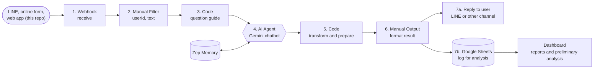
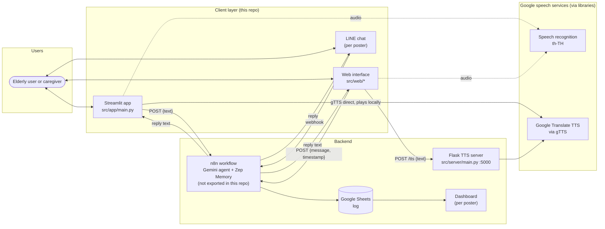
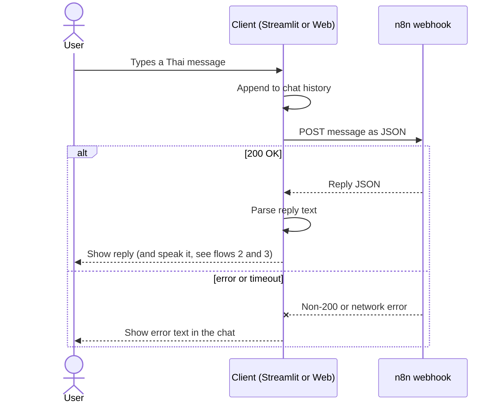
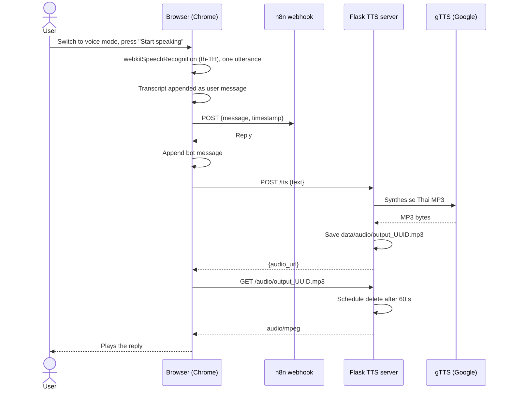
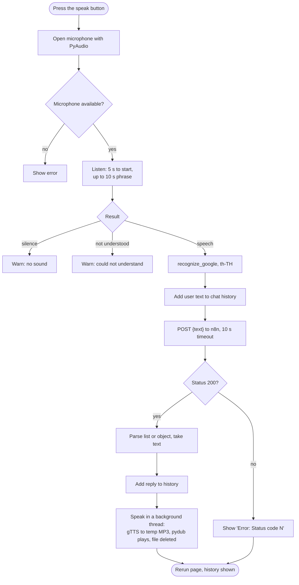
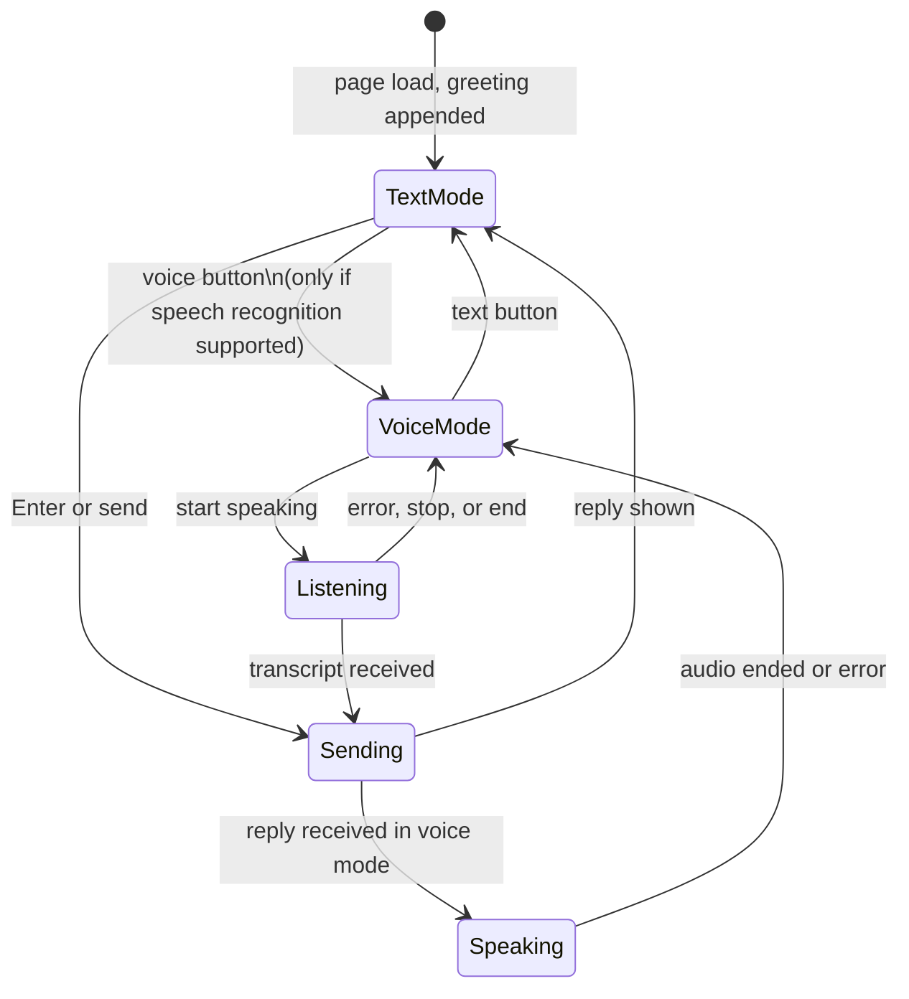
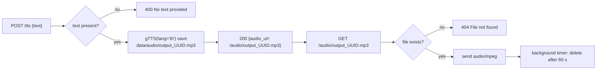

<div align="center">

# Tao Tun (เฒ่าทัน)

### Thai voice and text chatbot client for elderly care and serious-illness preparedness

**Super AI Engineer Season 5 · AIAT Thailand · Honorable Mention (2025)**

<p>


</p>

[Poster](https://canva.link/p2c75jg8eqr08jr) · [Presentation](https://canva.link/mfj1ue3um2cie0p)

</div>

---

## Contents

1. [Overview](#overview)
2. [What is in this repository](#what-is-in-this-repository)
3. [Tech stack](#tech-stack)
4. [Problem and impact](#problem-and-impact)
5. [Real system: the n8n workflow](#real-system-the-n8n-workflow)
6. [Architecture](#architecture)
7. [Flow diagrams](#flow-diagrams)
8. [Components in detail](#components-in-detail)
9. [Webhook contract](#webhook-contract)
10. [Getting started](#getting-started)
11. [Configuration](#configuration)
12. [Privacy and safety notes](#privacy-and-safety-notes)
13. [Known limitations](#known-limitations)
14. [Suggested next steps](#suggested-next-steps)
15. [Credits](#credits)

---

## Overview

Tao Tun is the conversational front end for a healthcare idea built in **Super AI Engineer Season 5**: an assistant that helps elderly people and their families talk about health, serious illness and preparing for it, in Thai, without having to type.

A user can:

- **type** a message,
- **speak** (Thai speech-to-text), and
- **hear the answer** (Thai text-to-speech).

The client does not contain the conversation logic. It forwards each message to a **webhook** (an [n8n](https://n8n.io) workflow) and shows or speaks whatever the workflow returns. Changing the assistant's behaviour means changing the workflow, not this code.

> **Scope of this repository.** This repo is the client layer: two user interfaces and a Thai text-to-speech server. The n8n workflow behind the webhook is **not exported into this repo**. Its design is documented below from the project poster ([Real system: the n8n workflow](#real-system-the-n8n-workflow)); statements about Gemini, Zep Memory, LINE, Google Sheets and the dashboard come from that poster, not from code in this repository. The assistant does not diagnose diseases or recommend medicine, and nothing in this repo gives medical advice.

**ภาษาไทย (สรุป):** เฒ่าทันเป็นส่วนติดต่อผู้ใช้ของแชทบอทสำหรับผู้สูงอายุและการเตรียมตัวรับมือโรคร้ายแรง ผู้ใช้พิมพ์หรือพูดภาษาไทยได้ ระบบส่งข้อความไปยัง webhook ของ n8n แล้วแสดงหรืออ่านคำตอบออกเสียง repo นี้มีเฉพาะฝั่งอินเทอร์เฟซและเซิร์ฟเวอร์แปลงข้อความเป็นเสียง ส่วนตรรกะการสนทนาอยู่ใน n8n (อธิบายจากโปสเตอร์ในหัวข้อ Real system) ซึ่งไม่ได้ export มาไว้ใน repo นี้

---

## What is in this repository

| Component | Path | Role |
|---|---|---|
| Streamlit app | `src/app/main.py` | Desktop prototype. Text chat plus microphone input; speaks replies locally. |
| TTS server | `src/server/main.py` | Flask API that turns Thai text into an MP3 and serves it briefly. |
| Web interface | `src/web/` | Browser UI (HTML, CSS, JS). Text mode and voice mode using the browser's speech recognition and the TTS server. |
| Webhook smoke test | `scripts/test_webhook.py` | Sends one message to an n8n webhook and prints the status. |
| Entry stub | `main.py` | Placeholder from `uv init`. Not used. |

```
taotun/
├── src/
│   ├── app/main.py        Streamlit voice and text chatbot
│   ├── server/main.py     Flask TTS server (gTTS), port 5000
│   └── web/
│       ├── index.html     Chat page, mode switcher
│       ├── script.js      STT, webhook call, TTS playback, UI state
│       └── style.css      Kanit font, card layout
├── scripts/test_webhook.py
├── data/audio/            Created at runtime for temporary MP3 files (gitignored)
├── pyproject.toml         Dependencies
└── main.py                Unused stub
```

---

## Tech stack

| Area | Technology | Used for |
|---|---|---|
| Language |  | Streamlit app, TTS server, test script |
| Desktop UI |  | Chat interface with session history |
| API server |  + Flask-CORS | `/tts` and `/audio/<file>` endpoints |
| Text to speech | gTTS (`lang='th'`) | Thai speech synthesis, MP3 output |
| Audio playback | pydub + ffmpeg | Local playback of the MP3 in the Streamlit app |
| Speech to text (desktop) | SpeechRecognition + PyAudio, `recognize_google` (`th-TH`) | Microphone capture and transcription |
| Speech to text (web) | Browser Web Speech API (`webkitSpeechRecognition`, `th-TH`) | In-browser transcription, Chrome |
| Orchestration |  | Seven-step workflow behind the webhook (per poster; not exported here) |
| LLM |  | Chatbot agent: answers, converses, analyses context (per poster) |
| Memory | Zep Memory | Conversation memory store (per poster) |
| Messaging |  | User channel for replies (per poster) |
| Logging |  | Stores conversations for later analysis (per poster) |
| HTTP client | requests (Python), `fetch` (browser) | Webhook and TTS calls |
| Front end |    | Web interface, Kanit font from Google Fonts |
| Packaging |  / pip | `pyproject.toml` (`flask`, `flask-cors`, `gtts`, `pyaudio`, `pydub`, `requests`, `speechrecognition`, `streamlit`) |

---

## Problem and impact

Source: the project poster (figures cited there from a Ministry of Public Health document, 2019).

- **Pain point:** medical staff are in short supply while the number of older adults keeps rising, so there is little time to take a health history and follow symptoms case by case. Baseline health data goes missing and care becomes uneven.
- **Scale (as reported on the poster):** by 2037 (BE 2580) Thailand is projected to be short of about **7,161 professional nurses**, even though more than 10,000 people graduate each year, because the number leaving the system keeps growing.
- **Impact if unaddressed:** older adults receive care late, health data is lost, risk of complications rises, and staff burnout increases.
- **Solution:** Tao Tun is a friendly AI chatbot that takes a health history and screens older adults' health through spoken or typed conversation (STT and TTS), communicates with emotional awareness, and adapts its manner to each person, **without diagnosing disease or recommending medicine**.
- **Expected outcomes:** less repeated work and fewer data-entry errors for staff, more time saved, and a more sustainable standard of elder care in the community.
- **Strengths:** understands emotion and adjusts behaviour for older adults; works as a companion that listens and analyses; reduces staff load and improves care quality.

The poster's tagline: *"We will give nurses their time back, and give patients peace of mind."*

---

## Real system: the n8n workflow

The poster describes a seven-step n8n workflow plus three user-facing parts: **UI** (a real-use web interface with TTS and STT), **Dashboard** (reports and preliminary analysis) and **Data** (collection of older adults' behaviour and history).

| # | n8n step | What it does |
|---|---|---|
| 1 | Receive data (Webhook) | Receives input from sources such as LINE, online forms or other apps |
| 2 | Select key fields (Manual Filter) | Keeps only what is needed, for example `userId` and `text` |
| 3 | Set the question guide (Code block) | Builds an initial set of questions that guides the AI agent's conversation |
| 4 | Call the AI chatbot (first bot) | **Gemini** answers, talks with the user and analyses content by context; results go to a memory system (**Zep Memory**) |
| 5 | Extra processing (Code block) | Transforms data and prepares it for saving or further analysis |
| 6 | Format the result (Manual Output) | Checks and arranges data into a suitable output shape |
| 7 | Send out | Replies to the user via **LINE** or another online channel, and **logs to Google Sheets** for later analysis |



Where this repo fits: the Streamlit app and the web page are two additional **sources** for step 1, and they supply the speech layer (STT in, TTS out) that LINE text chat does not have.

---

## Architecture



The two clients in this repo are independent. The Streamlit app synthesises speech by itself; the web page delegates synthesis to the Flask server because a browser cannot call gTTS.

---

## Flow diagrams

### 1. Text conversation (both clients)



### 2. Web interface, voice mode



### 3. Streamlit app, voice input



### 4. Web UI states



In voice mode the text input is disabled while listening. If the browser lacks `webkitSpeechRecognition`, or microphone access is denied, the voice button is disabled and the status line explains why (use Chrome and allow the microphone).

### 5. TTS server file lifecycle



---

## Components in detail

### Streamlit app (`src/app/main.py`)

- Page title "Tao Tun: Thai Chatbot", Thai UI strings.
- Keeps the conversation in `st.session_state.chat_history` as `(role, text)` pairs and re-renders it with `st.chat_message`.
- **Text input** through `st.chat_input`; **voice input** through a button that records one utterance (5 s wait, 10 s maximum phrase) and transcribes it with `recognize_google` in `th-TH`.
- `call_webhook()` posts `{"text": message}` with a 10 s timeout and accepts either an n8n list response (`[ {text: ...} ]`) or an object response, falling back to the stringified payload.
- `speak()` runs in a daemon thread: gTTS writes a temporary MP3, pydub plays it, the file is removed. Playback happens on the machine running Streamlit.

### Web interface (`src/web/`)

- **Text mode** and **voice mode** with a mode switcher. Greets the user on load.
- Speech recognition uses the browser's `webkitSpeechRecognition` (`th-TH`, single utterance, no interim results). Handles `network`, `no-speech` and `not-allowed` errors with Thai messages.
- Replies are sent to `N8N_WEBHOOK_URL` as `{message, timestamp}` (Asia/Bangkok). The response parser takes the first key of the returned object and the first array item's `output` field, which matches a typical n8n AI-agent response; otherwise it falls back to the key or pretty-printed JSON.
- In voice mode, the reply text is sent to the TTS server and the returned MP3 is played in a hidden `<audio>` element. A guard prevents overlapping playback.
- Extra buttons for testing: simulated speech (placeholder) and a TTS test phrase.

### TTS server (`src/server/main.py`)

- `POST /tts` with `{"text": "..."}` returns `{"audio_url": "/audio/<file>.mp3"}`.
- `GET /audio/<file>` streams the MP3 and deletes it 60 seconds later.
- CORS is enabled for all origins to simplify local testing.

---

## Webhook contract

The two clients send **different field names**. Make the n8n workflow accept both, or align them (see [Known limitations](#known-limitations)).

| Client | Request body | Reply shapes handled |
|---|---|---|
| Streamlit | `{"text": "<message>"}` | `[{"text": "..."}]` or `{"text": "..."}` |
| Web | `{"message": "<message>", "timestamp": "<th-TH local time>"}` | `{"<key>": [{"output": "..."}]}`, otherwise first key or JSON text |
| `scripts/test_webhook.py` | `{"message": "<message>"}` | Only checks the HTTP status |

---

## Getting started

### Prerequisites

- Python **3.12+** (`pyproject.toml` requires it)
- [uv](https://docs.astral.sh/uv/) or pip
- **ffmpeg** (pydub needs it to decode MP3 for local playback)
- **PortAudio** for PyAudio, needed only for microphone input in Streamlit (macOS: `brew install portaudio`)
- Google Chrome for the web voice mode
- An n8n instance with a webhook workflow (or any endpoint that matches the [contract](#webhook-contract))

### Install

```bash
git clone https://github.com/Dxrksvng/Healtcare-Super-ai-ss5.git
cd Healtcare-Super-ai-ss5
uv sync            # or: pip install -e .
```

### Run

```bash
# 1. TTS server (needed by the web voice mode), http://localhost:5000
python src/server/main.py

# 2. Streamlit app
streamlit run src/app/main.py

# 3. Web interface: serve the folder and open it in Chrome
cd src/web && python -m http.server 8000     # http://localhost:8000
```

Serve the web page over `http://localhost` rather than opening the file directly; browsers restrict microphone and speech APIs on some `file://` setups. I'd verify this in your browser before relying on it.

### Smoke-test the webhook

Edit the URL in `scripts/test_webhook.py`, then:

```bash
python scripts/test_webhook.py
```

> Status of verification: this README was written from reading the source. The apps were **not** run while writing it, so the run steps above are untested here.

---

## Configuration

Values are constants in the source, not environment variables.

| Setting | File | Default |
|---|---|---|
| `WEBHOOK_URL` | `src/app/main.py` | `http://localhost:5678/webhook/test` |
| `N8N_WEBHOOK_URL` | `src/web/script.js` | `http://localhost:5678/webhook/test` |
| `TTS_SERVER_URL` | `src/web/script.js` | `http://localhost:5000/tts` |
| TTS host and port | `src/server/main.py` | `0.0.0.0:5000`, `debug=True` |
| Audio folder | `src/server/main.py` | `data/audio/` |
| Language | all | Thai (`th`, `th-TH`) |

---

## Privacy and safety notes

This project is aimed at health conversations with older adults, so treat data handling seriously before any real use.

- **Speech and text leave the device.** Desktop speech recognition uses `recognize_google`, the browser uses Chrome's speech service, and gTTS sends reply text to a Google service. Do not route real patient information through this setup without a lawful basis and appropriate consent under Thailand's PDPA.
- **More processors per the poster.** The workflow sends conversation content to Gemini, a memory service (Zep) and Google Sheets, and replies through LINE. Each is a separate data processor with its own terms; map them in a PDPA data-flow review before real use.
- **No authentication, no encryption of the local audio files.** MP3 files are short-lived (deleted 60 seconds after being served) but exist unencrypted on disk first. If a file is never fetched it is not deleted by this code.
- **The TTS server runs with `debug=True` on `0.0.0.0`** and open CORS. That is acceptable for a local demo only. Do not expose it to a network: Flask's debugger can allow code execution.
- **Not medical advice.** The client performs no clinical logic. Any medical behaviour belongs to the workflow behind the webhook and must be reviewed by clinicians.

---

## Known limitations

- The n8n workflow (Gemini, Zep Memory, LINE, Google Sheets) and the dashboard are described from the poster but are not in this repo, so those capabilities cannot be verified from this code.
- Streamlit and web clients use different request fields (`text` vs `message`).
- `src/app/main.py` references `uuid` in a guarded expression without importing it; the guard makes it harmless, but the variable is unused.
- `src/web/index.html` is titled "n8n Chat Interface" and the "simulate speech" button is a placeholder.
- No automated tests; `scripts/test_webhook.py` is a manual check and its sample message should be replaced with a neutral one.
- The web voice mode depends on Chrome's `webkitSpeechRecognition`.
- No conversation persistence in the client; history lives in the Streamlit session or the page.
- `main.py` at the root is an unused stub.

---

## Suggested next steps

- [ ] Unify the webhook payload across both clients and document the n8n workflow (export it into the repo, without secrets).
- [ ] Move URLs and ports to environment variables; remove `debug=True`.
- [ ] Add a streaming or on-device Thai speech option to reduce reliance on external speech services.
- [ ] Larger text and high-contrast mode for elderly users; mobile-friendly layout.
- [ ] Consent screen, data-retention rules and audit logging for health conversations.
- [ ] Tests for the webhook parsing and the TTS endpoints.

---

## Credits

Built by the **ThaoThan Team** with **ASCEND CO., LTD.** and **Yuenyen Social Enterprise** for **Super AI Engineer Season 5** (AIAT, the Artificial Intelligence Association of Thailand). The project received an **Honorable Mention**. Project concept: *AI-powered elderly care and palliative preparation system*.

For educational and development purposes.
